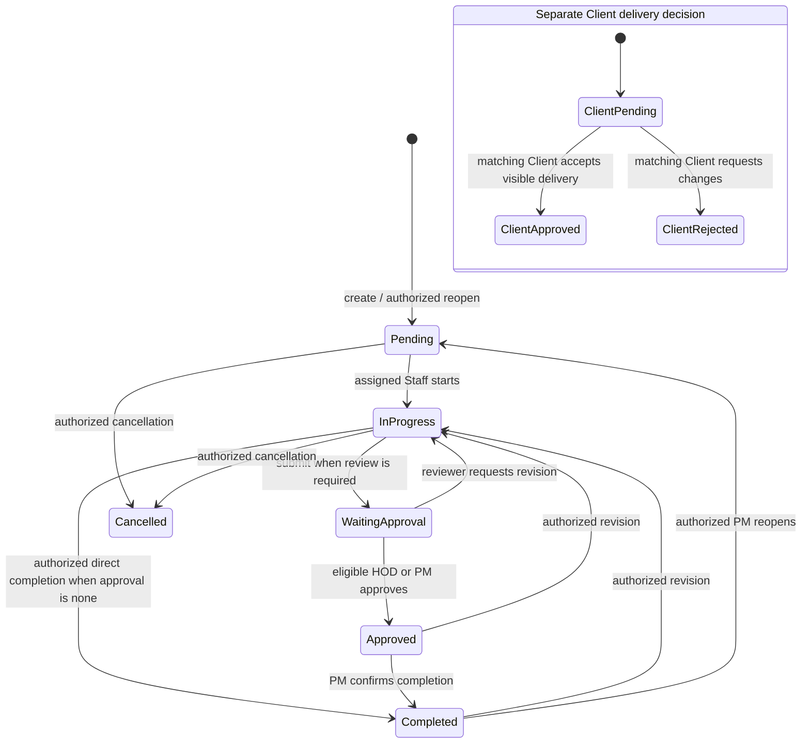

# AiTask Release Stabilization Report

**Assessment date:** 27 October 2026 (Asia/Kuala_Lumpur)  
**Branch:** `codex/release-stabilization-2026-10-26`  
**Starting commit:** `f3682201e6dc2a17ca529a822e07e83c1f8ffc3f`  
**Release decision:** **NO-GO for production.** Local release-candidate checks are recorded below; production and hosted service gates remain open.

## 1. Executive summary

This pass stabilized task creation, assignment, review-state persistence, supporting-file privacy, and the full browser regression. The task form continues to require the existing business and authorization fields, defaults the start date and priority, and leaves nonessential task information and attachments for later. PM accountability is retained when a project has no eligible HOD and no Staff assignee is selected. Database enforcement now checks project membership for assignment changes, including direct PM assignment.

Internal revision state no longer changes the Client's delivery decision. Supporting files use a separate private bucket and remain separate from review output and Client-visible evidence. Evidence is required at submission or completion only for tasks linked to a deliverable under the existing workflow rule.

The application changes and local release checks do not clear the production gate. The repository contains candidate migrations beyond the last production baseline recorded in the available reports; hosted role/RLS and Storage behavior, Realtime, backup and recovery, lifecycle policy approval, and production configuration remain unverified. No production data or schema was changed, and nothing was deployed.

## 2. Full browser regression

### Initial current-tree run

The preceding Stage 1/2 report had documented an older **372-test** run (349 passed, 18 failed, 5 not run). That was treated as historical evidence; the current tree was rerun before classifying these failures.

The initial one-worker run collected **379 tests**: **367 passed, 3 failed, 9 did not run** (34.8 minutes). It did not meet the release acceptance criteria.

| Failure | Classification and cause | Resolution |
| --- | --- | --- |
| Responsive project/HOD/Boss audit timed out | Test-structure/timing issue. One 30-second case combined three sign-ins, four viewport checks, screenshots, focus/scroll checks, and Axe runs. At 320px the HOD main region was 320/320px; the two reported overflowing elements were intentionally scrollable tablists. | Split the checks by role and viewport, retained table keyboard-scroll and Axe assertions, and limited overflow diagnostics to non-scrollable descendants. |
| Staff/Boss dashboard accessibility timed out | Test-structure/timing issue. One 30-second case ran four main/nav Axe audits across two identities and two viewport sizes. | Split into independent Staff/Boss and mobile/desktop tests; all four audits remain. |
| Pending evidence download test timed out | Test defect. It installed a route for `serviceFiles.ts` after opening a task, but `TaskSupportingFiles` had already loaded that module. The route callback was therefore not a reliable synchronization point. | Reworked the test around the actual session guard: cancel during the download handler's async import, verify a fresh same-session download succeeds, then switch identity during a new attempt and verify no second download begins. |

The nine tests not run in the initial failed run were not counted as passes. The final full-run totals and duration are recorded below.

The full run uses `playwright.config.ts`; it does not collect `e2e/pwa-install.spec.ts`, `e2e/login-recovery-i18n.spec.ts`, or `e2e/staging-release.spec.ts` because those paths are explicitly listed in `testIgnore`. They are excluded from the collected count, not counted as passing or skipped.

### Final full run

**PASS:** `PLAYWRIGHT_REUSE_SERVER=true pnpm exec playwright test --workers=1 --reporter=line` collected **385 tests: 385 passed, 0 failed, 0 skipped, 0 not run** in **29.6 minutes**. The run used one worker and did not update snapshots.

After the updated release-stabilization request, the full suite was rerun against this checkout on 27 October 2026. The first sandboxed launch stopped before collection because the web server could not bind to `127.0.0.1:4180` (`EPERM`); the approved full-suite invocation then completed successfully. Playwright's last-run record reports `status: passed` with an empty `failedTests` list. This setup failure is classified as an environment restriction, not a test result.

Focused verification of the repaired browser cases passed: **9 passed** across the responsive cases, four Staff/Boss accessibility cases, and evidence-download session case. The changed E2E files also passed ESLint.

## 3. Task field requirements

“Assignment” below means routing the work to an eligible owner. Starting work also requires the existing task-access and workflow-transition checks. No future-stage evidence or approval requirement was moved into task creation.

| Field | Required at creation? | Assignment / start | Submission / review | Completion | Configuration and roles |
| --- | --- | --- | --- | --- | --- |
| Task title | Yes | No additional requirement | No | No | Required for authorized creators. |
| Company | Yes, unless supplied by the selected Project or delivery context | No additional requirement | No | No | Company record must exist. Client cannot create internal tasks. |
| Project | Optional for PM company-only tasks; required for Staff/HOD creation unless using a linked delivery context | Project membership is enforced for PM, HOD, and Staff routing | No | No | Existing project access rules preserved. |
| Department | Yes | Determines eligible HOD/Staff and task scope | Reviewer eligibility follows current department/project rules | No | Required for authorized creators; eligible choices are role-scoped. |
| Responsible HOD | Required for PM creation when one or more HODs are eligible for the chosen project and department | HOD retains accountability while delegating to Staff | Eligible reviewer required when the selected review path needs one | No | When no eligible HOD exists, PM can assign eligible Staff directly or leave the task unassigned while remaining accountable. |
| Staff assignee | Optional at creation when later assignment is supported | Must be assigned to an eligible Staff member before Staff work can begin | Assigned worker submits or completes only when allowed by the approval mode | No | PM/HOD assign within project and department scope; Staff cannot self-assign. |
| Description / instructions | No | No | No | No | Optional; edits use existing role-based task permissions. |
| Priority | No; defaults to **Medium** | No | No | No | Existing priority values and authorized editing remain. |
| Start date | Yes as stored; defaults to the current date | No additional requirement | No | No | Existing required date contract retained. |
| Due date | No | No | No | No | Optional. Missing/invalid dates do not make work overdue. |
| Service | Yes under current form/application validation; defaults to **Design** | No additional requirement | No | No | Not made optional because current validation requires it. Changing that contract needs explicit product and database approval. |
| Client visibility | No; non-Client creators default to **Internal only** | Existing project/task privacy applies | Client delivery review is available only for authorized visible delivery work | No | Authorized roles may select current visibility values; Clients gain no internal-editing access. |
| Attachment URL / label | No | No | Counts as evidence only where the existing linked-deliverable rule accepts it | Same conditional rule as submission | Optional HTTPS link fields. Binary supporting files are added later through a separate flow. |
| Supporting files | No | No; upload later while task is active | Supporting files do not satisfy delivery evidence by themselves | Not required for simple internal tasks | Optional, private, team-only files; PDF/images up to 100 MB each, maximum 50 per task. Client access is denied. |
| Review requirement | No; defaults to project policy (`inherit`) | Does not block creation or start | Effective project/task approval mode selects review path | Review is required only when configured; no-approval work can use its authorized direct-completion path | PM may select the existing `inherit`, `none`, `hod`, or `pm` modes where the form exposes them. No new setting was added. |
| Notes, company details, Facebook page, website | No | No | No | No | Optional. Supplied URLs must be valid HTTPS URLs. |

No Company, department, HOD, service, membership, or evidence database constraint was relaxed. The creation action remains **Create & open task**, which describes creation accurately even when the Staff assignee is blank.

## 4. Assignment results

- **PM with eligible HOD:** creation routes to an eligible HOD and records the existing pending-HOD assignment state. If multiple HODs are eligible, the PM must choose one.
- **PM with no eligible HOD:** PM may assign eligible project Staff directly or create the task unassigned. An unassigned task retains PM creator/accountability and stays in the existing `Pending` lifecycle state. No new status was introduced.
- **HOD delegation:** the HOD assigns eligible Staff and remains the responsible HOD. PM project oversight remains in place.
- **Staff acceptance:** the existing `Accept assignment` acknowledgment is optional; starting work also records acceptance. This pass added no acceptance prerequisite or decline flow.
- **Cross-project Staff:** one Staff account may work across projects when explicitly assigned to each project. Project membership is checked per task; a PM cannot assign a non-member or manage another PM's project through direct or full-edit routes.
- Assignment is locked during submitted, approved, completed, and cancelled states until the existing revision/reopen flow permits a change. Override paths retain their audit reason.

Evidence includes routing unit tests, `pm_hod_staff_assignment.test.sql`, `explicit_project_membership_scope.test.sql`, the PM no-HOD browser scenario, HOD delegation coverage, and authenticated local database role tests. The new membership guard is a candidate migration and has not been applied to production.

## 5. Task status and review results

### Stored workflow states

The current workflow uses `Pending`, `In Progress`, `Waiting Approval`, `Approved`, `Completed`, and `Cancelled`, plus existing custom labels. `Revision Requested` is not a normal stored status: a revision records feedback/history, increments `revisionCount`, clears stale review/completion data, and returns work to `In Progress`. A legacy/configured `Revision` value remains handled by the UI.

Client approval is stored and audited separately from internal task review/completion. The candidate migration preserves Client approval history when an internal reviewer requests a revision or a task is reopened. PM finalization after an internal approval remains distinct from HOD review. The Cancelled-to-reopen path was not independently verified in this pass.

PM assignment overrides remain scoped and require a recorded reason. Where independent cover is required for Boss Koo's self-review, the override action also requires and stores an audited reason; it is not a general review bypass.

### Displayed versus derived indicators

- **Overdue**, **due today**, and **due soon** are derived from a valid due date and open status; they are not task statuses. Missing or invalid due dates are not overdue. Completed and cancelled tasks are excluded from overdue counts.
- **Progress percentage** is a derived operational milestone (for example: assigned, in progress, revision, waiting approval, approved, completed). It is not an alternate lifecycle status.
- Client-facing task presentation translates internal review labels into delivery-facing language. Client delivery approval does not turn an internally open task into a completed task.
- HOD dashboards distinguish work awaiting HOD routing from tasks genuinely lacking an assignee. Empty assignees are never mapped to a fictitious Staff member.
- Assignment, status, revision, and review changes retain actor/time history and role-specific notifications. The visible task work-history list is bounded; immutable entity history remains the audit source. Hosted history retention/access was not verified.

The internal-revision/client-decision migration and task progress migration were replayed in the disposable database and covered by pgTAP and unit regressions. Current production persistence remains unverified.

## 6. Attachment and evidence results

| Scenario | Result and boundary |
| --- | --- |
| Create and complete a simple internal task without files | Permitted when the task is not linked to a deliverable and approval policy allows direct completion. |
| Create without files, add supporting files later | Creation/start do not require files. Authorized team users can add private supporting files while work is active. Supporting files are separate from output evidence. |
| Submit linked work without evidence | Blocked with a clear English/Simplified Chinese message. The rule applies when the task is linked to a deliverable and is entering review/approval/completion; it does not impose universal evidence requirements on ordinary internal work. |
| Revision and resubmission | Existing output/submission history is retained; authorized revision returns work to the Staff execution path and another review is required under the configured mode. |
| Unauthorized access | Client projections omit `supportingAttachments`; Client and foreign-task access to the private supporting bucket is denied by the disposable database policies/tests. |

Supporting files are stored in the separate private `task-supporting-files` bucket. Storage and metadata checks enforce the task/workspace path, authorized team actor, PDF/image MIME allowlist, 100 MB per-file limit, 50-file limit, and append-only attachment references. Supporting files cannot be changed after submission/closure. Client-visible deliverable evidence remains in its existing bucket/workflow. Browser verification confirms session changes cancel pending downloads and a fresh session can retry; the low-level `isCurrent` download guard also has unit coverage.

The disposable Supabase run exercised Storage policies locally. This is not a production Storage authorization test.

## 7. Dashboard and reporting consistency

Source-record fixtures and domain tests verify that:

- Open, waiting-review, approved, completed, unassigned, department workload, and project progress calculations use the underlying task records and do not treat submitted work as completed.
- Unassigned tasks remain open and are counted in their department/project scope without being assigned to a nonexistent user.
- Missing due dates do not count as overdue; due-today tasks are separated from upcoming and overdue work; completed/cancelled work is excluded from overdue totals.
- Desktop and mobile dashboard fixtures reconcile one overdue task with one overdue-production task after the underlying due date changes, and ignore monthly cycles that do not cover the current date.
- Cross-department staff counts are deduplicated at the person level; task workload remains attributed to the task's department.

Evidence includes `e2e/dashboard-accuracy.spec.ts`, dashboard domain tests, and reporting domain tests. These checks use controlled local source records; they do not reconcile against a live production snapshot.

## 8. Security and role authorization

Local positive and negative coverage includes:

- **Super Admin:** existing authorized administrative visibility and management routes.
- **PM:** company-only and project task creation, HOD routing, no-HOD direct/unassigned fallback, scoped direct assignment, override reason, task updates, review/finalization, and authorized reopening.
- **HOD:** department/project-scoped work, eligible Staff delegation, review and revision, and denial of out-of-scope targets.
- **Staff:** assigned-task visibility, optional acceptance, start, work updates, supporting-file upload, output evidence, submission, revision response, and resubmission. Staff cannot approve internal review or self-assign to a foreign project member.
- **Client:** only authorized visible delivery review; internal task editing and private supporting-file access are denied.
- **Project isolation:** a shared Staff member can access tasks in multiple projects where assigned, while PM and HOD commands remain constrained to their project/department scope.

The current local database suite includes authenticated-role and forged-command checks. Production identities, hosted RLS behavior, and deployed Storage policies were not exercised.

## 9. Automated verification evidence

Commands and results recorded for this candidate:

| Command | Result |
| --- | --- |
| `pnpm check` | PASS |
| `pnpm lint` | PASS; the three changed E2E files also passed focused ESLint after regression fixes. |
| `pnpm test` | PASS: 122 test files, 952 tests. |
| `pnpm verify:architecture` | PASS: 230 source files; 1,316 runtime edges, 180 type-only edges; no runtime or type-inclusive cycles. |
| `pnpm verify:i18n:strict` | PASS: 0 findings across 230 source files. |
| `pnpm build` | PASS; Vite emitted a non-fatal advisory for a chunk above 500 kB. |
| `pnpm verify:bundle` | PASS: eager JS graph 1,039.9 KiB raw / 299.3 KiB gzip, within the 300 KiB cap; chart budget passed. |
| `pnpm verify:supabase:rollout` | PASS against a disposable local stack: all 130 migrations replayed, including 10 beyond the rollout's applied-production baseline; 77 pgTAP files / 1,179 assertions passed; schema lint/advisors and local Auth/REST/Storage/workflow checks passed. Realtime was excluded. |
| `AITASK_PHASE5_UAT=true pnpm verify:supabase:rollout` | BLOCKED before pgTAP completion: local Realtime's Erlang `cpu_sup`/`memsup` supervisors terminated. Realtime is **NOT VERIFIED**. |
| Focused repaired Playwright cases | PASS: 9/9. |
| `PLAYWRIGHT_REUSE_SERVER=true pnpm exec playwright test --workers=1 --reporter=line` | PASS on the 27 October rerun: 385 collected, 385 passed, 0 failed, 0 skipped, 0 not run; 29.6 minutes. |

Candidate migrations added in this worktree:

| Migration | Purpose |
| --- | --- |
| `20261026120000_separate_internal_revision_from_client_approval.sql` | Keep internal revision/reopen transitions from overwriting the Client decision. |
| `20261026123000_enforce_project_assignment_membership.sql` | Enforce PM project membership on direct and routed assignment mutations. |
| `20261026130000_private_task_supporting_files.sql` | Add private supporting-file storage, ownership/path validation, Client projection exclusion, and activity history. |
| `20261026135000_preserve_revision_stage_progress.sql` | Preserve the revision progress milestone when the finalizer recalculates task progress. |
| `20261026141000_allow_current_release_notice_acknowledgement.sql` | Accept the current release notice identifier while retaining the existing identifier. |

The database replay used disposable local services and dummy fixtures. It is not a hosted migration, RLS, Storage, Realtime, backup/recovery, or production authorization test.

## 10. Remaining production blockers

The latest available go-live audit, dated 25 October 2026, classifies production as **NO-GO** and records:

- Production was recorded at 124 migrations through `20261023154255`; the candidate then contained 125, with `20261024090000_security_boundary_hardening` absent from production. This task's disposable replay now covers 130 local migrations. No live migration query was run in this pass, so present-day production parity is **unverified**.
- Production application deployment was at parent commit `8eeba61ebe3e02825447201b18c6d1b0acfec595`, not this candidate; no deployment was attempted.
- No approved member deactivation/deletion and project/client archive/reopen policy is recorded. The historical audit-retention follow-up migration requires explicit business-owner approval before production use.
- Fresh backup/restore evidence, monitoring/alerting, and hosted environment metadata remain unavailable or unverified.
- Leaked-password protection was reported disabled; the production organization was reported on Supabase Free, which does not support that control. The security advisor also reported 19 authenticated `SECURITY DEFINER` notices and 9 RLS-without-policy informational notices; these require the existing documented review and must not be represented as newly cleared.
- Production role-boundary/RLS checks, hosted Storage behavior, Realtime delivery, notification delivery, concurrent reviewer conflicts, and hosted dashboard accuracy were not run.

The separately maintained `FINAL_PRODUCTION_GATE.md` is dated 17 October and also records **NO-GO**, citing migration parity, missing fresh backup/recovery and hosting metadata, leaked-password protection unavailable on the reported Free plan, and lifecycle/deletion policy approval. Its 112-migration count is older than the 25 October audit's 124-migration snapshot and is retained only as historical gate evidence.

The production facts above are the last recorded read-only audit evidence, not a fresh live check. This stabilization pass did not mutate production, approve policy, or deploy.

## 11. Final decision

**NO-GO for production release.** The task creation, assignment, review, privacy, and local verification work is recorded as a local release candidate for review. Production promotion remains blocked by migration parity and historical SQL reconciliation, lifecycle-policy approval, backup/recovery and environment evidence, and the outstanding hosted security and role-verification gates. No production data, schema, settings, or deployment were changed.
