# AiTask Task Status, Review & Approval Workflow Audit

**Assessment date:** 2026-10-26 (Asia/Kuala_Lumpur)  
**Scope:** Current working tree, task lifecycle and authorization rules, status labels, dashboard/report calculations, notifications/history, relevant unit and browser checks, and repository database guards.  
**Release recommendation:** **PASS WITH CONDITIONS.** Local workflow checks pass after the fixes below. Persistent storage still overloads a client decision field for internal revision, so this audit does not claim production readiness. No production data, database migration, or deployment was changed.

## 1. Executive Summary

The application uses a string task status stored in each task entity, with a managed list of common statuses. The verified built-in values are `Pending`, `In Progress`, `Waiting Approval`, `Completed`, and `Cancelled`; `Approved` is also a reserved internal review milestone. Custom values are supported. `Revision Requested` is not a normal persisted status: a revision increments `revisionCount` and returns work to `In Progress`.

Confirmed improvements in this working tree:

- Client-facing task labels now hide internal review values. Calendar and Delivery Tracker use client delivery labels, and the task list/details use a shared client status presentation helper.
- Internal “Waiting Approval” and “Approved” labels are localized consistently as “Waiting for review” / “Review approved” (Chinese: `待审核` / `审核已通过`) across the reviewed task, dashboard, project, settings, and notification surfaces.
- Revision progress can be derived from `revisionCount`; it no longer depends on treating a client rejection as the only revision signal.
- Regression coverage now checks that client-facing internal revisions do not appear as a client rejection, that a completed task can be reopened to `Pending` with an assignee notification, and that a Client sees a delivery label for internal review in Calendar.
- The unassigned-task service test now exercises reopening to `Pending`, consistent with the rule that a task must have an assignee before it can enter `In Progress`.

The main outstanding workflow defect is in hosted persistence: the current SQL guard requires `clientApprovalStatus = 'Rejected'` when an internal reviewer returns work for revision. This conflates internal rework with the Client’s decision field. The UI now infers the Client-facing decision from the appended client decision history, but the stored model remains coupled. A forward migration is needed to separate these concepts; approval is required before writing or applying it.

No approved instruction to hide `In Progress` or remove legacy values was found in the reviewed task requests or repository workflow documentation. `In Progress` remains a real execution status. No active application or migration use of `OTEC` was found. No status values or task records were deleted.

## 2. Actual Task Lifecycle

### Status inventory

| Stored value / field | Meaning and entry | Normal exit / next actor | Reporting impact |
| --- | --- | --- | --- |
| `Pending` | Created or queued work; also the safe reopen state when the task has no assignee. | Assigned Staff starts work; scoped manager assigns or routes it. | Open; contributes to workload and can be overdue. |
| `In Progress` | Assigned work is being executed or revised. | Assigned Staff submits to review when required, or completes directly when approval is `none`; a reviewer/PM may request a revision back to this state. | Open; progress is an operational milestone, not completion. |
| `Waiting Approval` | Work has been submitted for internal review. `workState.reviewRequestedBy/At` records the handoff. Submission is rejected if required reviewer configuration is missing. | Authorized HOD/PM reviews; review can approve or return work for revision. | Open and counted in the pending internal review queue; not completed. |
| `Approved` | Internal review has approved submitted work. This is a reserved workflow milestone, not one of the default editable status settings. | PM completes the task, or an authorized reviewer returns it for revision. | Open until final completion; progress milestone is 80%. Client review remains independent. |
| `Completed` | Internal task completion is confirmed; `isCompleted` and `completedAt` are updated. | Authorized PM/HOD review action can return it for revision; an authorized PM can reopen through the status selector. | Completed unless reopened; excluded from open and overdue counts. |
| `Cancelled` | Work is cancelled. It is a default system status. | A scoped status change may restore work, but a dedicated Cancelled reopen flow was not verified in this pass. | Excluded from open/overdue counts. |
| Custom status | Boss Koo can add a string status. Defaults and statuses currently used by tasks cannot be deleted. | Depends on the configured status options and task access. Custom values do not define their own workflow semantics. | Generic status reporting; no special review/completion meaning unless it matches a reserved value. |
| Client decision field | `clientApprovalStatus`: `Pending`, `Approved`, or `Rejected`; recorded separately in the Client decision history. | Matching Client may accept or request changes when delivery review is enabled and the task is client-visible. | Drives client delivery/acceptance reporting, not internal approval totals. **Hosted internal revision currently also writes `Rejected`; see D-01.** |

`TaskStatus` is typed as `string`; status values are stored in the JSON task payload, while `task_status` provides the managed list. No task-status database enum or check constraint was found. The normal revision action does not introduce a new status: it requires submitted work and an assignee, records feedback, increments `revisionCount`, clears completion/review metadata, and returns the task to `In Progress`. A legacy/configured `Revision` value may exist, but it is not a default status.

### State-transition diagram

```mermaid
stateDiagram-v2
  [*] --> Pending: create
  Pending --> InProgress: assigned Staff starts
  InProgress --> WaitingApproval: submit when review is required
  InProgress --> Completed: assigned Staff completes when approval is none
  WaitingApproval --> Approved: authorized HOD or PM approves
  WaitingApproval --> Completed: PM finalizes an approval-none task
  Approved --> Completed: PM confirms completion
  WaitingApproval --> InProgress: request revision; assignee required
  Approved --> InProgress: request revision; assignee required
  Completed --> InProgress: request revision; assignee required
  Completed --> Pending: authorized PM reopens through status selector
  Pending --> Cancelled: scoped task editor cancels
  InProgress --> Cancelled: scoped task editor cancels

  state "Separate Client delivery decision" as ClientDecision {
    [*] --> ClientPending: visible work reaches Client review
    ClientPending --> ClientAccepted: Client approves delivery
    ClientPending --> ClientChanges: Client requests changes
  }
```

The diagram shows the standard verified paths. Exact reviewer selection depends on task/project approval mode, project/department scope, configured accountable lead/cover, and whether a responsible PM can review. Client acceptance is a separate decision and does not itself complete an internally open task. A Client request for changes appends a client decision event; an internal revision is currently distinguishable in the UI by that event history, even though hosted storage still reuses the same status field.

## 3. Role Permission Matrix

| Action | Super Admin | Project Manager | HOD | Staff | Client |
| --- | --- | --- | --- | --- | --- |
| View tasks | Broad workspace administration; task actions still pass workflow checks. | Portfolio/project scope, plus authorized projectless responsibilities. | Department/project scope. | Assigned and otherwise permitted work. | Matching company and client-visible work only. |
| Start, update, attach evidence, submit/resubmit | Authorized operational access; self-review safeguards still apply. | Within managed scope. | Department-scoped task edits allowed by field policy. | Current assignee; may start, update work, attach evidence, and submit. | Cannot change internal task progress. |
| Approve internal review | Independent reviewer or explicit reasoned override where permitted. | Responsible PM may review within the managed portfolio and may exercise the PM review authority above the HOD lane. | Eligible department reviewer for tasks in scope. | Cannot approve own submission. | Cannot approve internal review. |
| Request revision | Within administrative workflow rules. | Within managed portfolio; may return submitted, approved, or completed work. | Eligible department reviewer; must have submitted work and an assignee. | Cannot request internal review revision. | May request changes only through the separate client delivery review action. |
| Complete | Broad administrative authority subject to workflow checks. | Completes after required approval or when the task workflow permits bypass. | Not the normal finalizer; approval does not imply PM completion. | Direct completion only for assigned Staff work with internal approval mode `none`; otherwise submit. | Acceptance is not internal completion. |
| Reopen | Administrative scope subject to task guards. | May return completed work to `Pending` or request revision within owned scope. | May request revision within department scope. | Cannot reopen completed work. | Cannot reopen internal work. |
| Change task assignment | Administrative scope, with assignment guards. | Managed project scope; assignment locks apply during review/completion/cancellation. | Department/project delegation scope. | Cannot assign work to others. | Denied. |

The PM rule is enforced against project ownership/portfolio scope; it does not make unrelated project tasks editable. HOD authority is department and task scoped. Super Admin status is broader but does not silently remove review safeguards: self-approval requires an explicit reason where the independent-review rule applies. The database role/assignment boundary has an unresolved related finding D-04 from the prior assignment audit, noted in Remaining Risks.

## 4. Review Workflow Matrix

| Scenario | Verified behavior | Next action / actor | Result |
| --- | --- | --- | --- |
| Review required | Effective task mode (`hod`, `pm`, or inherited project default) requires review. Legacy tasks without an explicit mode keep the compatibility rule: only `requiresInternalApproval === false` disables it. | Assigned executor submits; configured reviewer acts. | `In Progress → Waiting Approval → Approved → Completed`. |
| Review optional | Mode `none` does not create an internal review hop. The assigned Staff member can complete from `In Progress`; an optional `Waiting Approval` submission is rejected by the transition guard. | Staff completes directly, or scoped PM finalizes an allowed no-review task. | No unnecessary internal queue item. |
| HOD review | HOD must be an eligible reviewer in the department and project scope and cannot approve their own work without an allowed override. | HOD approves or requests revision. | Approval becomes `Approved`; revision returns to `In Progress`. |
| PM review / override | A responsible PM can review in the managed portfolio, including the PM authority above the HOD lane. A missing department HOD can route to an eligible responsible PM rather than leave a task without a reviewer. | PM approves, requests revision, or finalizes after approval. | Decision is scoped and recorded through task/workspace history. |
| Revision | Only submitted/approved/completed work may be returned, and an assignee is required. Feedback is stored as a comment; revision count increments; completion timestamp and stale review metadata are cleared. | Assignee updates work and resubmits. | `Waiting Approval/Approved/Completed → In Progress → Waiting Approval`. |
| Client acceptance | Available only for authorized, client-visible delivery work at the client review stage. Decision event is appended to `approvalHistory`. | Client accepts or requests changes; PM may still need to complete internal work. | Does not substitute for internal approval/completion. |
| Reopening | There is no separate Reopen button. An authorized PM can select `Pending` to reopen a completed task; completion state/timestamp clear and the assigned person receives a notification. Revisions use the dedicated revision action. | PM, then the assignee. | Historical audit remains; current completion counts fall. |

## 5. Status Consistency Report

- **Persisted values:** Task status remains the raw canonical string. `Approved` is reserved and normalized by `resolveTaskStatus`; other accepted values come from the configured status list. No schema/status-value change was made.
- **Internal UI labels:** A shared task status label helper now presents `Waiting Approval` and `Approved` consistently in English/Chinese. Search/filter values remain the stored values, while option labels are localized.
- **Client UI:** Task list/details, Calendar, and Delivery Tracker use client-facing stage labels. Calendar previously rendered the raw status; this was fixed and covered by an E2E test. Internal state such as `Waiting Approval` is no longer shown to Clients.
- **Progress:** `Completed`/`isCompleted` maps to 100%; `Waiting Approval` to 60%; `Approved` to 80%; a revision is 50%; active work is 30%. Revision count now provides the app-level revision signal. Server progress still reflects the legacy `Rejected` coupling until a migration is approved.
- **Dashboard/report categories:** `isTaskCompleted` means `isCompleted || status === 'Completed'`. `isTaskOpen` excludes completed and `Cancelled` tasks. Pending internal review is open work whose status is exactly `Waiting Approval`. Overdue is open work with a due date before today; completed tasks are not overdue. Project and staff totals use the same completion/open helpers, preventing a task from being both currently completed and pending review.
- **History and notifications:** Submission records reviewer/request metadata; internal task changes are tracked through work state/history; client decisions append events. The database has an append-only `aitask_entity_history` guard. Task-facing `workHistory` itself is a bounded recent-history list (50 entries), so it is not the complete audit archive. Notification recipients are resolved from task responsibility/reviewer scope; revision requests notify the assignee.

## 6. Test Results

| Scenario / command | Expected | Actual | Result | Evidence / commit |
| --- | --- | --- | --- | --- |
| `pnpm test` | Unit/domain suite passes. | 122 files, 949 tests passed. | **PASS** | Full run after lifecycle regression addition; HEAD `f368220`, working tree changes uncommitted. |
| Focused client label/progress suite | Client/internal labels and revision progress agree with lifecycle rules. | 3 files, 27 tests passed. | **PASS** | `clientPortal.test.ts`, `localeLabels.test.ts`, `taskProgress.test.ts`. |
| `pnpm check`, `pnpm lint` | TypeScript and lint clean. | Both passed after Calendar/Delivery Tracker changes. | **PASS** | Current working tree. |
| `pnpm verify:i18n:strict` | No missing/unsafe localization findings. | 0 findings across 228 source files. | **PASS** | Current workflow run. |
| `pnpm verify:architecture` | No runtime dependency cycles. | 9 checks passed; 228 files; 0 runtime or type-inclusive cycles. | **PASS** | Current working tree. |
| `pnpm verify:migrations` | Repository migration files are present/non-empty. | 125 SQL migrations verified non-empty. | **PASS** | This validates repository files, not deployment or policy behavior. |
| `pnpm build` | Production bundle builds. | Build passed; Vite reports the existing `workspaceRuntime` chunk is over 500 kB. | **PASS** | Non-fatal chunk-size warning. |
| Review workflow browser suite | Submit, HOD/PM review, revision, and finalization work. | Initial combined run: 22 passed, 2 failed. Both failures were rerun in isolation and passed; one was an onboarding overlay race, the other a transient hydration timeout. | **PASS on rerun** | `workflow-review-gate`, `hod-review-handoff`, `task-role-readiness`, `delivery-review`; 24 initial tests. |
| Client Calendar status regression | Client sees delivery language for an internal review state. | 1 passed after scoping the assertion to the task card. | **PASS** | `e2e/calendar-overview.spec.ts`. |
| Accessibility | Keyboard/dark-mode accessibility check passes. | 1 browser test passed. | **PASS** | `e2e/accessibility.spec.ts`. |
| Responsive role/route matrix | Role routes remain usable at desktop/tablet/mobile widths. | 1 matrix test passed. It logged a 320px Boss Dashboard main-content width diagnostic (346px) with a horizontally scrollable data region. | **PASS WITH OBSERVATION** | `e2e/responsive-audit.spec.ts`; not caused by the status-label change and not independently fixed here. |
| Disposable Supabase rollout / pgTAP | SQL authorization and workflow tests run against replayed migrations. | **Blocked before SQL tests**: local Realtime and Storage containers were unhealthy (`LegacyHealthCheckTimeoutError`). | **BLOCKED** | No production database was touched. The prior assignment audit’s successful disposable run found one assignment-scope assertion failure (D-04). |
| Live production records, concurrent reviewers, network retry, hosted Storage/Realtime | Verify production data and hosted behaviors. | Not run in this pass. | **NOT VERIFIED** | Requires a healthy non-production hosted environment and approved DB changes where applicable. |

There is no task-specific commit for the working-tree audit changes. Current HEAD is `f368220`; those changes and this report are uncommitted. The separate production guard hotfix is recorded below.

## 7. Defect Register

| ID | Severity | Root cause / affected role | Files changed | Fix and regression evidence | Status |
| --- | --- | --- | --- | --- | --- |
| D-01 | P1 — internal/client decision conflation | Hosted HOD revision guard requires `clientApprovalStatus = 'Rejected'` for internal review return. This can misrepresent internal rework as a Client rejection. | `src/shared/authorization/clientPortal.ts`, `src/shared/rules/taskProgress.ts`, task detail/list displays and tests. | Client display now treats `Rejected` as a Client rejection only when the latest appended client decision event says so; revision progress uses `revisionCount`. Unit tests pass. | **Mitigated in UI; database fix pending approval.** |
| D-02 | P2 — Client saw an internal status | Calendar rendered `task.status` directly for Clients. | `src/modules/calendar/pages/Calendar.tsx`, `src/modules/services/pages/DeliveryTracker.tsx`, `e2e/calendar-overview.spec.ts`. | Calendar now uses the Client task label helper; Delivery Tracker localizes internal labels and preserves client stage labels. Client Calendar E2E passes. | **Fixed locally.** |
| D-03 | P2 — inconsistent review wording | Modules displayed the same persisted review status with inconsistent English/Chinese labels. | Shared locale helper and task/dashboard/project/notification UI call sites; `src/shared/i18n/i18n.ts` includes a missing Chinese revision-validation message. | Shared label mapping; locale, full unit, lint, build, and i18n checks pass. | **Fixed locally.** |
| D-04 | P1 — assignment project-scope SQL gap (carry-forward) | The prior assignment audit’s disposable pgTAP suite accepted a PM no-HOD direct assignment to Staff outside `project.staffMemberIds`. | `supabase/tests/database/pm_hod_staff_assignment.test.sql` contains the regression assertion; no SQL migration was added. | Prior audit reproduced 1 failure in 1,162 pgTAP assertions; see `AITASK_TASK_ASSIGNMENT_ACCEPTANCE_AUDIT_2026-10-26.md`. | **Open; migration requires approval.** |
| D-05 | P3 — browser harness race | Handoff E2E attempted the review action while the welcome/onboarding dialog was still visible. | `e2e/hod-review-handoff.spec.ts`. | Test now waits for the welcome dialog to close; isolated handoff and legacy HOD full-editor reruns pass. | **Test reliability fixed.** |

## 8. Remaining Risks

- **Approval required for the status persistence fix.** Proposed forward migration: represent internal review/revision state independently from `clientApprovalStatus`; update the trigger/RPC guard so internal revision does not write a Client decision; derive internal revision progress from `revisionCount`; preserve all existing approval events and history. Historical `Rejected` values without a matching client decision event require a conservative backfill rule and regression fixtures. No migration was created or applied.
- **Carry-forward authorization issue D-04 remains open.** The prior audit reproduced an out-of-project direct assignment accepted by the disposable database guard. The current rollout could not be repeated because local Realtime/Storage failed health checks. Keep production authorization release-gated until the approved database fix and pgTAP rerun pass.
- **Custom statuses are free-form labels.** They can be configured without a defined workflow meaning; operational guidance should keep them descriptive and avoid using them to represent review/completion semantics.
- **Task-facing work history is bounded to 50 entries.** The immutable entity history is the authoritative archive, but production retention/access behavior was not verified in this pass.
- **Not exercised here:** live notification delivery/realtime, Storage upload/download, simultaneous reviewers, stale browser writes, database retries after a successful submit, reviewer deactivation, removal from project during review, and reopen after project closure.
- **No production readiness claim:** this is local application/UI evidence plus repository-source inspection. The disposable database rollout was blocked and no production or staging account was used.

## 9. Final Recommendation

**PASS WITH CONDITIONS for the local application workflow; NO-GO for production release until the approval-gated database items are resolved.**

The task lifecycle supports assignment, execution, submission, optional review, approval, revisions, resubmission, completion, reopening, and separate Client acceptance. Local unit, focused browser, accessibility, responsive, TypeScript, lint, localization, architecture, and build checks pass. Client-facing status exposure and review-label consistency were fixed in the working tree.

Approval is required before implementing the forward migration for D-01 and the assignment-scope guard from D-04. After approval, run the migrations and pgTAP suite on a healthy disposable database, verify hosted Client/HOD/PM behavior, and then reassess production readiness. No production data, migration, or deployment was changed in this audit.

## Post-audit production release update — 2026-10-26

The app-only guard for unassigned work was released from the current live source commit as `f39c335f7911c9992368bf45d218f6899f0b6334` (`fix: require task ownership before work starts`). Vercel deployment `dpl_H2LbAUCwu94FU9EFBZdabN51fu67` is READY on the production domain [aitask-virid.vercel.app](https://aitask-virid.vercel.app). Its `/build-info.json` reports the expected commit and production channel; the root route returns HTTP 200.

The release blocks creating or transitioning a task into `In Progress`, and blocks a revision return, when the task has no assigned owner. Verification: 921/921 unit tests, lint, and the production TypeScript/Vite build passed. No database migration or production task row was changed. The broader D-01/D-04 database issues remain open, and the previously observed orphan task still needs an authorized PM/HOD to assign its owner.
