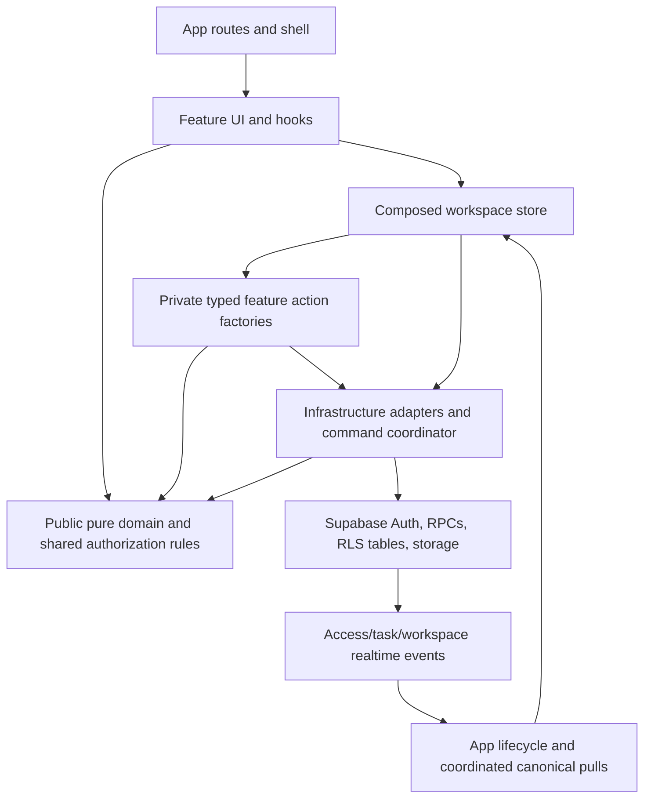

# AiTask modular architecture

AiTask remains a React SPA with one persisted Zustand workspace store. This refactor changes internal organization, not routes, screens, command payloads, or authorization. Read the [original assessment](assessment.md), [batch and cleanup record](refactoring-log.md), and [verification evidence](verification.md) alongside this guide.

## Verified technology stack

Versions were read from `package.json`, `pnpm-lock.yaml`, and installed package metadata; dependency ranges are not treated as resolved versions.

| Layer | Technology | Resolved version | Responsibility |
| --- | --- | --- | --- |
| Frontend | React / React DOM | 18.3.1 | Browser UI |
| Build | Vite / React plugin | 6.4.3 / 4.7.0 | Compilation, development, lazy chunks |
| Language | TypeScript; JavaScript tooling; SQL | 5.8.3 | Typed application, scripts, database logic |
| Runtime/tooling | Node / pnpm | Node 22.x required / 10.4.1 pinned | Development and CI |
| Routing | React Router DOM | 7.18.2 | Browser router, guarded nested routes |
| State | Zustand with persist middleware | 5.0.12 | One workspace state and separate toast state |
| UI | Custom React components; Lucide | Lucide 0.511.0 | Existing controls and icons; no component-library replacement |
| Styling | Tailwind CSS / clsx / tailwind-merge | 3.4.19 / 2.1.1 / 3.5.0 | Existing utility classes and theme tokens |
| Backend client | Supabase JS | 2.117.3 | Auth, RPC, database, storage, realtime |
| Database | Managed Supabase PostgreSQL | Server version not verified | RLS tables, RPC commands, triggers, pg_cron |
| Authentication | Supabase Auth; explicit local demo credentials | Managed service | Hosted identity and development fixtures |
| APIs | Two Supabase Edge Functions; versioned database RPCs | Deno runtime not verified | Member invitations/account operations and feedback |
| Realtime | Supabase channels plus coordinated pulls | Supabase JS 2.117.3 | Access, task, and workspace invalidation |
| Forms | Controlled React state, native constraints, custom validation | Application code | Recovery, draft reconciliation, save locking |
| Localization | Custom English/Chinese dictionaries and provider | Application code | UI copy and formatting |
| Dates/charts | date-fns / Recharts | 4.1.0 / 3.8.1 | Calendar calculations and lazy reports |
| PWA | vite-plugin-pwa / Workbox | 1.3.0 / 7.4.1 | Installable shell and offline assets |
| Unit/browser tests | Vitest / Playwright / axe | 4.1.10 / 1.61.1 / 4.13.0 | Domain, permission, workflow, accessibility regression |
| Lint | ESLint | 9.39.4 | Existing TypeScript/React rules |
| Deployment | Vercel SPA; GitHub Actions | Managed services | Rewrites, headers, staging and release gates |

The application version remains 3.0.0. No dependencies or lockfile resolutions were changed. Database, Auth, Edge runtime, hosting, and CI service versions cannot be inferred from the client package version.

## Layout and ownership

```text
src/
  app/                  # Routing, shell, lifecycle, store composition, account-aware hooks
  modules/
    authentication/     # Login, password/account actions, local credential rules
    users/              # Registrations, members, roles, department membership
    projects/           # Project ownership, lifecycle, milestones, Companies route
    clients/            # Client profiles, client portal, client workspace entry
    tasks/              # Assignment, execution, evidence, review/revision, task UI
    services/           # Catalog, plans, recurring cycles, renewals, deliveries, uploads
    notifications/      # Feed, read receipts, presentation, popups, sounds
    dashboard/          # Persona views and operational read models
    reports/            # Reporting read models and lazy charts
    calendar/           # Calendar page, ranges, metrics
    settings/           # Account/settings view and diagnostics
    feedback/           # Feedback form/results
    help/               # Tutorials, onboarding and contextual help
  shared/               # UI primitives, authorization/rules, forms, i18n, common types
  infrastructure/       # Supabase transport, contracts, serialization, persistence, diagnostics
  mock/                 # Explicit local demo fixtures and actions
  main.tsx, sw.ts        # Framework entry points
  index.css             # Existing global styles and theme aliases
supabase/               # Existing SQL, migrations, pgTAP, Edge Functions and cron definitions
scripts/architecture/   # Import-boundary and dependency-cycle checks
```

A feature owns its relevant pages, components, hooks, application actions, domain helpers, and colocated tests. Small features have only the folders they need. Recurring work belongs to services. Task reviews belong to tasks; delivery reviews belong to services. `Approvals.tsx` manages users and roles, so it belongs to users. Department membership is shared authorization input, not a new standalone feature.

The protected administrator continues to use the existing `isSuperAdmin`/Boss Koo mechanisms. The role union remains Project Manager, HOD, Staff, Client.

## Dependency interfaces

`architecture-boundaries.json` is the explicit list of externally consumable leaf files for each module. `composition` entries are private action factories accessible only to the workspace composition root. Every other module file is private to its owner. Changing this list is an architectural decision, not an automatic response to a failing check.

Use named imports from a declared leaf entry point. Route pages remain direct lazy imports. Avoid whole-feature barrels: public UI and public pure rules serve different dependency directions and should not be loaded together. Existing cross-feature UI composition is explicit; this does not imply that all files in a feature may import all files in another. The checker verifies actual file-level runtime and type-inclusive cycles rather than treating a whole feature as one eagerly loaded file.



The diagram includes event/data flow; event arrows are not JavaScript import edges.

Rules enforced by `pnpm verify:architecture`:

- Cross-module imports use declared public leaf files; app composition alone assembles private action factories.
- Action factories receive typed `set` and `get`; they never import the composed store.
- Shared code does not import app or feature implementations.
- Infrastructure does not import the app, composed store, or feature UI/hooks.
- Domain rules do not import UI or the composed store.
- Production code does not import test files. Static and literal dynamic imports are checked for runtime cycles; type-inclusive cycles are reported separately.

Account-aware save/recovery hooks and access-denied/error shell components live in app because they require workspace composition or app lifecycle. The shared authorization kernel contains genuinely cross-domain permission, department, project-lifecycle, and task-review rules; it does not own screens or mutations.

## State, backend, and permissions

`app/store/workspaceStore.ts` creates exactly one Zustand workspace store. Feature action factories close over its guarded setter and getter. They are composed before use without creating additional stores or copying state. Backend coordination remains at the app composition boundary so cross-domain commands retain their original ordering and atomicity.

The persistence key is still `market-task-storage`, version 5. Local demo serialization, migration, partialization, and rehydration are unchanged. Secure mode still persists no workspace rows in that envelope. Mutation suppression flags and the local mutation epoch remain shared live values, including notification-read and remote-snapshot suppression.

The backend separates:

- `workspaceContracts`: RPC types, command kinds, schema/protocol constants.
- `workspaceTransport`: bounded requests, session binding, refresh, timeout classification.
- `workspaceSerialization`: member/client/task projections and row serialization, receiving the current baseline explicitly.
- `workspaceRuntimeContracts`: typed dependencies supplied to lazy member, notice, and notification transports, without importing the coordinator back.
- `secureWorkspace`: canonical baseline, retained pending commands, version checks, retries, loading/saving, and command orchestration.

Feature actions call existing adapters and RPCs. Feedback pages keep their existing Edge Function calls. New data access belongs in an appropriate feature data helper or infrastructure adapter rather than in presentation components. Infrastructure reports typed storage-warning events; app composition maps them to the existing localized warning toasts.

Frontend authorization remains a presentation/action guard. PostgreSQL RLS and command functions remain authoritative. Do not broaden SQL permissions to make a component easier to move. Preserve project-ID ownership, department scope, custom permissions, and client projection/privacy. Do not derive authorization from a role label alone.

## Sessions, realtime, and recurring work

App lifecycle still boots the backend, binds auth changes, starts/stops synchronization, checks pending work, and coordinates update/offline notices. The store's existing realtime coordinator subscribes to member access, workspace revision, and task changes through infrastructure. It coalesces canonical pulls, retries failed channels, and retains the existing 15-second safety poll. Logout/account changes stop listeners and invalidate in-flight session work. Notification receipts, feed cursors, unread counts, sounds, and rollback behavior remain separate concerns within notifications.

Local recurring generation remains in services and its existing lifecycle hook. Hosted generation/reminders stay in their existing database routines, triggers, and pg_cron schedules. No scheduled or background operation was removed. The service worker still caches the shell/assets, not Supabase application data.

## Tests and future modules

Run `pnpm verify:architecture`, `pnpm check`, `pnpm lint`, `pnpm test`, and `pnpm build`. Then run the existing browser, PWA, localization, bundle, and disposable database gates relevant to the change. See the verification report for actual outcomes and known baseline failures; a successful build is not evidence that hosted database workflows passed.

For a new module, choose an existing business responsibility first, colocate tests, reuse shared primitives and authorization inputs, publish only necessary leaf entry points, and register private actions in the existing store only if state is needed. Add an isolated domain helper before inventing another service layer. Preserve lazy page boundaries and avoid changes to persistence or RPC shapes during a structural move. Test critical permissions and failure recovery before moving the next workflow.
