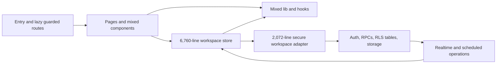

# Original architecture assessment

Inspected on 24 October 2026 before structural changes. Repository source, configuration, lockfile, scripts, tests, SQL migrations, Edge Functions, and release workflows were the source of truth. This is a structural assessment, not a new security audit or a claim about the currently deployed database.

## Starting structure

```text
src/
  App.tsx, main.tsx, sw.ts, index.css
  app/                  # AppContent, lifecycle hook, route guards
  pages/                # 14 route pages
  components/           # Primitives, shell, domain UI, and workflow forms together
  hooks/                # Generic and feature-specific hooks mixed
  lib/                  # Domain, authorization, backend, validation, presentation mixed
  store/                # Workspace store, toast store, action helper, regression tests
  types/                # Shared model declarations
  modules/notifications/# Existing partial feature boundary
  mock/                 # Local fixture data
supabase/               # Schema, migrations, pgTAP, Edge Functions, preflight tooling
scripts/, e2e/, .github/workflows/
```

The initial static inventory contained 319 TypeScript/TSX files including tests and 1,459 static import edges. No static runtime cycle was found in that first scan; it did not by itself establish the absence of dynamic/type-only cycles. The final checker adds those distinctions.

## Responsibilities and communication

- `App.tsx` creates the browser router; `AppContent` lazy-loads pages inside guarded nested routes. The shell provides navigation, search, notices, popups, and global dialogs.
- Pages and workflow components use Zustand selectors/actions, local controlled form state, custom authorization helpers, and feature-specific calculation helpers. The feedback pages directly invoke their existing Edge Function.
- The workspace store coordinates optimistic projections, notification intent, authorization checks, cross-domain updates, backend capability gates, persistence, retries, canonical reloads, and realtime invalidation.
- The secure workspace adapter handles normalized table reads, client projections, member mutations, retained commands, command partitioning, optimistic versions, notification RPCs, and lazy transport helpers.
- Database RLS, command functions, storage policies, triggers, and scheduled routines enforce hosted authorization and integrity. Browser permission checks supplement these boundaries.
- Dashboards derive persona-specific read models from the existing store rather than introducing a separate query cache. Reports share some of these calculations.
- Task and service actions generate local notification intent; hosted routines provide authoritative notifications. The app coordinates read receipts and refreshes from canonical state.



## Weaknesses and risk priorities

| Priority | Finding | Risk / refactoring opportunity |
| --- | --- | --- |
| 1 | Workspace store mixed authentication, members, tasks, projects, services, receipts, persistence, and sync | Split typed actions around the existing guarded setter; retain one coordinator and transaction boundary |
| 1 | Secure adapter mixed contracts, projections, network/session handling, retained state, and presentation | Separate pure contracts/serialization/transport; preserve retry state together and report warnings to app composition |
| 1 | Authorization spans frontend helpers and authoritative SQL | Move callers without changing predicates, project IDs, membership rules, command names, or SQL policies |
| 1 | Recurring services link tasks, plans, cycles, deliveries, and frozen snapshots | Preserve multi-domain mutations, renewals, scheduled generation, and version checks as one existing workflow |
| 2 | `Approvals.tsx` was 2,478 lines and owns registrations/members/roles rather than task reviews | Place it in users, extract its existing review panel, and separate state/handlers from rendering |
| 2 | Tasks page was 1,227 lines with selectors, filtering, save/rollback handlers, and markup | Extract a private orchestration hook while preserving all rendered JSX |
| 2 | Large flat pages/components/lib directories obscured ownership | Colocate actual domains and tests; keep genuinely shared authorization and workflow rules focused |
| 2 | Existing notifications module was bypassed through private paths | Declare explicit leaf interfaces and finish separating its transport, rules, receipts, hooks, and presentation |
| 2 | Some shared-looking hooks/components depended on the workspace store or app lifecycle | Classify these as app composition rather than allowing shared-to-app dependencies |
| 3 | Tests and verification scripts referenced original source locations | Move mocks, browser import URLs, route interception, source-inspection targets, and Vite chunk configuration with implementations |
| 3 | Similar validation/status/date/permission helpers exist for different workflows | Reuse existing canonical helpers; merge only when behavior is demonstrably identical |

No duplicate rule was removed merely because its name looked similar. User-administration role descriptions and normalization descriptions differ intentionally. Task reviews and delivery reviews also have different evidence, authorization, and state-transition requirements.

## Baseline verification findings

Before extraction, type checks, lint, production build, bundle budgets, and 919 unit tests passed. The build already emitted the large-chunk and stale Browserslist-data warnings. Initial browser testing exposed existing task-save recovery failures; a preserved source snapshot was used for the full before/after comparison.

After Docker became available, the original disposable database rollout failed while replaying an existing HOD authorization migration with `HOD assignment boundary was not found`. Later concurrent security work added a migration without updating the release repair manifest, causing the final rollout preflight to fail earlier. Neither failure was bypassed or fixed as part of this structural refactor.

See [verification.md](verification.md) for completed browser results and the precise remaining validation limits.
